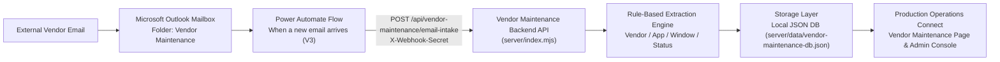

# Vendor Maintenance Management & Microsoft Outlook Integration Setup Guide

**Application:** Production Operations Connect (Alaska Airlines IT Operations)  
**Module:** Vendor Maintenance (`/vendor-maintenance` / `vendor-maintenance.html`)  
**Primary Integration Path:** Microsoft Outlook (`Vendor Maintenance` Folder) -> Power Automate (`When a new email arrives (V3)`) -> Backend Ingestion API (`/api/vendor-maintenance/email-intake`) -> Local JSON Storage (`server/data/vendor-maintenance-db.json`) -> React Dashboard (`Vendor Maintenance`)

---

## 1. Architecture Overview

The **Vendor Maintenance** module automatically captures maintenance notifications, service outage advisories, application upgrades, and security bulletins received from external operational vendors in Microsoft Outlook, processes and classifies those emails, stores structured records, and displays them in the **Production Operations Connect** web portal.



### Core Architectural Principles
1. **Zero Secret Exposure in Frontend:** The browser client (`vendor-maintenance.html` and `admin-react`) never holds backend secrets or webhook tokens.
2. **Preserve Original Vendor Evidence:** Every ingested record stores the verbatim `emailSubject`, `emailBodyText`, and raw `emailBodyHtml` (sanitized before rendering) alongside the automated `extractedSummary` so operators can always verify the vendor's exact wording.
3. **Strict Status & Timezone Discipline:**
   - Incoming incident/outage emails are **never** marked `Completed` simply because an email arrived; completion requires explicit resolution confirmation (`resolved`, `restored`, `all clear`, `maintenance completed`) or an authorized operator status update.
   - Missing or ambiguous timezones are **never** silently assumed to be UTC when the email lacks timezone indicators; records are flagged `Requires Review`.
4. **Idempotent Deduplication:** Re-deliveries from Power Automate or manual reprocessing requests are deduplicated using `(sourceMailbox, outlookInternetMessageId || outlookMessageId)`.

---

## 2. Microsoft 365 Prerequisites

Before configuring the automated pipeline, ensure the following resources are available:

- **Exchange Online Mailbox:** A dedicated shared or operations mailbox (recommended: `vendor-maintenance@alaskaair.com` or `noc-vendor-updates@alaskaair.com`) accessible by the IT Operations service account.
- **Power Automate License:** Standard Microsoft 365 Power Automate license (plus Premium connector license if using the direct `HTTP` action to call the backend webhook API).

---

## 3. Outlook Mailbox Setup

1. Open **Microsoft Outlook** (Web `https://outlook.office.com` or Desktop) signed in with the operations service account or shared mailbox delegate.
2. Confirm that external vendor notification distribution lists (e.g., SITA, Smart4Aviation, Jeppesen, TRAX, Airbus, Aireon, AeroData, Dynamic Source, AMES) deliver advisories to this mailbox.
3. Record the primary SMTP address of the mailbox (e.g., `vendor-maintenance@alaskaair.com`) in both **Admin Settings -> Vendor Maintenance Integration** and the backend `.env` file (`OUTLOOK_MONITORED_MAILBOX`).

---

## 4. Creating the `Vendor Maintenance` Folder

1. In Microsoft Outlook, locate the monitored mailbox folder pane.
2. Right-click **Inbox** (or the mailbox root) and select **Create new folder** (or **New Folder**).
3. Name the folder exactly:
   ```text
   Vendor Maintenance
   ```
4. If nested under Inbox, the folder path in Power Automate will be `/Inbox/Vendor Maintenance` (or `Vendor Maintenance` if created at the top level).

---

## 5. Outlook Rules Configuration

Create Inbox rules in Outlook so that vendor maintenance notifications are routed automatically into the `Vendor Maintenance` folder while keeping unrelated chatter out:

1. Open **Outlook Settings (Gear Icon) -> Mail -> Rules -> Add new rule**.
2. **Rule Name:** `Route External Vendor Maintenance Notifications`
3. **Add a condition:**
   - **Sender address includes:**
     - `sita.aero`, `smart4aviation.aero`, `jeppesen.com`, `boeing.com`, `trax.aero`, `airbus.com`, `aireon.com`, `aerodata.aero`, `dynamicsource.se`, `ames.aero`, `sabre.com`, `amadeus.com`, `panasonic.aero`, `collinsaerospace.com`, `honeywell.com`
   - **OR Subject or body includes any of these keywords:**
     - `Scheduled Maintenance`, `Maintenance Window`, `Service Outage`, `Service Interruption`, `Planned Outage`, `Degradation`, `Security Advisory`, `Release Notes`, `System Upgrade`, `Emergency Maintenance`
4. **Add an exception (optional):**
   - **Except if subject includes:** `Invoice`, `Billing Statement`, `Marketing Newsletter`
5. **Add an action:**
   - **Move to:** `Vendor Maintenance`
6. Enable **Stop processing more rules** and click **Save**.

---

## 6. Power Automate Flow Setup

### Step-by-Step Flow Creation

1. Sign in to **Power Automate** (`https://make.powerautomate.com`).
2. Click **+ Create -> Automated cloud flow**.
3. **Flow name:** `Production Operations Connect - Vendor Maintenance Intake`
4. **Trigger:** Search for and select **Office 365 Outlook - When a new email arrives (V3)** (or **When a new email arrives in a shared mailbox (V2)** if using a shared mailbox).

### Step 1: Configure Trigger (`When a new email arrives (V3)`)
- **Folder:** Click the folder picker icon and select **`Vendor Maintenance`** (e.g., `Inbox -> Vendor Maintenance`).
- **Include Attachments:** `No` (metadata is captured safely; binary attachments are not executed).
- **Importance:** `Any`
- **Only with Attachments:** `No`

### Step 2: Condition — Basic Validation & Loop Prevention
Add a **Condition** control to ignore internal auto-replies:
- `From` **is not equal to** `vendor-maintenance@alaskaair.com`
- **AND** `Subject` **does not contain** `Automatic reply:`

### Step 3: Action (If Yes) — HTTP POST to Backend Ingestion API
Add an **HTTP** action:
- **Method:** `POST`
- **URI:** `https://<your-backend-host>/api/vendor-maintenance/email-intake` (or `http://localhost:4050/api/vendor-maintenance/email-intake` via on-premises gateway / tunnel during testing)
- **Headers:**
  ```json
  {
    "Content-Type": "application/json",
    "X-Webhook-Secret": "<YOUR_VENDOR_MAINTENANCE_WEBHOOK_SECRET>"
  }
  ```
- **Body (Power Automate Dynamic Expression Schema):**
  ```json
  {
    "outlookMessageId": "@{triggerOutputs()?['body/id']}",
    "outlookInternetMessageId": "@{triggerOutputs()?['body/internetMessageId']}",
    "conversationId": "@{triggerOutputs()?['body/conversationId']}",
    "senderEmail": "@{triggerOutputs()?['body/from']}",
    "emailSubject": "@{triggerOutputs()?['body/subject']}",
    "emailBodyHtml": "@{triggerOutputs()?['body/body']}",
    "emailBodyText": "@{triggerOutputs()?['body/bodyPreview']}",
    "receivedDate": "@{triggerOutputs()?['body/receivedDateTime']}",
    "importance": "@{triggerOutputs()?['body/importance']}",
    "hasAttachments": "@{triggerOutputs()?['body/hasAttachments']}",
    "sourceMailbox": "vendor-maintenance@alaskaair.com",
    "folderName": "Vendor Maintenance",
    "originalEmailWebLink": "https://outlook.office.com/mail/deeplink?ItemID=@{encodeUriComponent(triggerOutputs()?['body/id'])}"
  }
  ```

### Step 4: Configure Retry Policy & Error Notification
1. Click the three dots (`...`) on the **HTTP** action -> **Settings**.
2. Set **Retry Policy:**
   - **Type:** `Exponential Interval`
   - **Count:** `4`
   - **Interval:** `PT10S`
   - **Minimum Interval:** `PT5S`
   - **Maximum Interval:** `PT1H`
3. Add a parallel branch or subsequent action configured with **Configure run after -> has failed / has timed out** to send an alert email or Teams post to the IT Operations Admin channel if ingestion fails after all retries.

---

## 7. Persistent Record Schema (`vendor-maintenance-db.json`)

The standalone backend persists structured maintenance records in `server/data/vendor-maintenance-db.json` with the following fields:

| Field Name | Type | Required | Indexed | Notes |
| :--- | :--- | :--- | :--- | :--- |
| `id` | String | Yes | Yes | Internal record ID (`vmu-...`) |
| `vendorId` | String | No | Yes | Matches `master-data.js` vendor ID (e.g., `sita`, `smart4aviation`) |
| `vendorName` | String | Yes | Yes | Matched vendor name or `"Unknown"` |
| `senderEmail` | String | Yes | Yes | Normalized lowercase sender email |
| `emailSubject` | String | Yes | No | Original email subject |
| `emailBodyText` | String | No | No | Preserved plain-text email body |
| `emailBodyHtml` | String | No | No | Raw HTML body (sanitized before UI render) |
| `receivedDate` | ISO-8601 UTC | Yes | Yes | ISO-8601 UTC timestamp |
| `updateType` | Choice | Yes | Yes | `Scheduled Maintenance`, `Service Outage`, `Application Update`, `Security Advisory`, `Performance Degradation`, `General Announcement`, `Unknown / Requires Classification` |
| `applicationName` | String | No | Yes | Matched application (e.g., `ACARS`, `WAM`, `S4A`) or `"Unknown"` |
| `maintenanceStart` | ISO-8601 UTC | No | Yes | Extracted window start or null |
| `maintenanceEnd` | ISO-8601 UTC | No | No | Extracted window end or null |
| `timeZone` | String | No | No | Explicit timezone (e.g., `UTC`, `America/Los_Angeles`) or `"Not provided"` |
| `status` | Choice | Yes | Yes | `New`, `Scheduled`, `In Progress`, `Investigating`, `Completed`, `Cancelled`, `Requires Review` |
| `severity` | Choice | No | No | `Critical`, `High`, `Medium`, `Low`, `Unknown` |
| `operationalImpact` | String | No | No | Extracted operational impact statement |
| `extractedSummary` | String | No | No | Automated summary distinct from original email |
| `originalEmailWebLink` | URL / String | No | No | Validated `outlook.office.com` / `outlook.office365.com` link |
| `outlookMessageId` | String | Yes | Yes | Exchange message ID |
| `outlookInternetMessageId` | String | No | Yes | RFC 5322 Message-ID for deduplication |
| `conversationId` | String | No | Yes | Used for correlating follow-up/cancellation emails |
| `sourceMailbox` | String | Yes | No | Monitored mailbox address |
| `processingStatus` | Choice | Yes | Yes | `Processed`, `Completed with Review Flag`, `Failed` |
| `processingError` | String | No | No | Validation/timezone/matching warnings |
| `attachments` | Array | No | No | Safe metadata JSON array (`fileName`, `size`, `contentType`) |
| `processingHistory` | Array | No | No | Audit log array |
| `lastProcessedAt` | ISO-8601 UTC | Yes | No | Most recent processing timestamp |

---

## 8. API Authentication

All write/mutation endpoints on the backend API (`POST /api/vendor-maintenance/email-intake`, `PATCH /api/vendor-maintenance/:id`, `POST /api/vendor-maintenance/:id/reprocess`, `PUT /api/vendor-maintenance/admin/settings`) require authentication via either:

- **Header:** `X-Webhook-Secret: <VENDOR_MAINTENANCE_WEBHOOK_SECRET>`
- **Header:** `Authorization: Bearer <VENDOR_MAINTENANCE_WEBHOOK_SECRET>`

Requests missing a valid token are rejected with `401 Unauthorized`.

---

## 9. Required Permissions

Follow the principle of least privilege:

- **Power Automate Account:** Read access only to the `Vendor Maintenance` mailbox folder (`Mail.Read` or `Mail.Read.Shared` scoped to the operations mailbox).

---

## 10. Environment Variables

Copy `.env.example` to `.env` before starting the backend service:

| Variable | Purpose | Required |
| :--- | :--- | :--- |
| `VENDOR_MAINTENANCE_PORT` | HTTP port for backend server (default `4050` / `8787`) | Yes |
| `VENDOR_MAINTENANCE_WEBHOOK_SECRET` | Shared secret authenticating Power Automate & admin actions | Yes |
| `OUTLOOK_MONITORED_MAILBOX` | Monitored Outlook mailbox address | Yes |
| `OUTLOOK_MONITORED_FOLDER_NAME` | Target folder (`Vendor Maintenance`) | Yes |
| `OUTLOOK_APPROVED_SENDER_DOMAINS` | Comma-separated approved sender domains | Optional |
| `VENDOR_MAINTENANCE_STORAGE_PROVIDER` | `local-json` | Yes |
| `VITE_VENDOR_MAINTENANCE_API_URL` | Frontend API base URL | Optional |

---

## 11. Local Development Setup

1. **Copy Environment Variables:**
   ```powershell
   Copy-Item .env.example .env
   ```
2. **Start the Backend Ingestion API Server:**
   ```powershell
   node server/index.mjs
   ```
   The API server starts on `http://localhost:8787/api/vendor-maintenance`.
3. **Open Production Operations Connect:**
   - Open `home.html` or `vendor-maintenance.html` directly or serve the project directory over HTTP.
   - To rebuild the frontend bundles after modifying React components in `admin-react/src`:
     ```powershell
     node admin-react/scripts/build-file-bundle.mjs
     ```

---

## 12. Production Deployment Steps

1. Deploy `server/index.mjs` to an internal Node.js service host (Azure App Service, Container Apps, or IIS/Windows Service).
2. Configure environment variables (`VENDOR_MAINTENANCE_WEBHOOK_SECRET` and `VENDOR_MAINTENANCE_STORAGE_PROVIDER=local-json`) in your host configuration.
3. Ensure HTTPS/TLS termination is enforced on the webhook endpoint (`https://<host>/api/vendor-maintenance/email-intake`).
4. Build the static frontend bundle (`admin-react/scripts/build-file-bundle.mjs`) and deploy the static files (`vendor-maintenance.html`, `js/vendor-maintenance.bundle.js`, `css/vendor-maintenance.css`, `admin-react-dist/`) to the internal web host.
5. Enable the Power Automate flow and verify health via `GET /api/vendor-maintenance/summary`.

---

## 14. Testing Incoming Emails

You can test the full email ingestion and extraction pipeline in three ways:

1. **In-App Test Ingestion Modal (`Test Email Intake` button on `/vendor-maintenance` or in `Admin Settings`):**
   - Click **Test Email Intake** in the top-right toolbar of the Vendor Maintenance page.
   - Choose one of the realistic vendor email presets (SITA ACARS Scheduled Maintenance, Smart4Aviation S4A Outage, or Unknown Sender / Missing Timezone) or paste raw email fields, then click **Process & Ingest Email**.
2. **Direct Webhook API Call (`curl` / PowerShell):**
   ```powershell
   Invoke-RestMethod -Method Post `
     -Uri "http://localhost:4050/api/vendor-maintenance/email-intake" `
     -Headers @{ "X-Webhook-Secret" = "replace-with-strong-webhook-secret-in-production" } `
     -ContentType "application/json" `
     -Body (@{
       outlookMessageId = "AAMkAGI2THVSAAA-TEST-001"
       outlookInternetMessageId = "<test-001@sita.aero>"
       conversationId = "AAQkAGI2-CONV-001"
       senderEmail = "SITA Operations <acars.support@sita.aero>"
       emailSubject = "[MAINTENANCE] SITA ACARS Primary Gateway Window"
       emailBodyText = "Scheduled Maintenance for ACARS. Maintenance Start: 2026-11-15 06:00 UTC. Maintenance End: 2026-11-15 08:00 UTC. Impact: Brief 90-second fail-over."
       receivedDate = "2026-10-25T18:00:00Z"
       sourceMailbox = "vendor-maintenance@alaskaair.com"
       folderName = "Vendor Maintenance"
       originalEmailWebLink = "https://outlook.office.com/mail/deeplink?ItemID=AAMkAGI2THVSAAA-TEST-001"
     } | ConvertTo-Json)
   ```
3. **Demo Data Preview Toggle:**
   - Toggle **Preview Demo Data** in the Vendor Maintenance header to inspect sample scenarios (`DEMO DATA` badged and isolated from production records).

---

## 15. Reprocessing Failed Emails

When an email has `ProcessingStatus = Processed with Warnings` or `Status = Requires Review` (for example, after adding a new vendor domain or application alias):

1. Locate the record in the **Vendor Maintenance** table (or filter by **Status: Requires Review**).
2. Click the **Reprocess (`↻`)** action button on the row, or open **View Details -> Processing & Audit History -> Reprocess Email Extraction**.
3. The extraction engine re-evaluates the preserved `emailSubject`, `emailBodyText`, and `senderEmail` against the latest vendor directory (`master-data.js`) and custom alias rules **without creating a duplicate record**, and appends a `Reprocessed` entry to `processingHistory`.

---

## 16. Troubleshooting Guide

| Symptom | Root Cause | Resolution |
| :--- | :--- | :--- |
| Banner states `Outlook Integration Not Configured` | `integrationConfigured` is `false` and no webhook events have arrived yet | Configure the mailbox in **Admin Settings -> Vendor Maintenance Integration** and enable the Power Automate flow. |
| Webhook returns `401 Unauthorized` | `X-Webhook-Secret` header does not match `VENDOR_MAINTENANCE_WEBHOOK_SECRET` | Verify the header value in the Power Automate HTTP action matches `.env`. |
| Record marked `Requires Review` with warning `Maintenance date/time detected without an explicit timezone` | Vendor email mentioned a date/time without `UTC`, `PDT`, `PST`, `EST`, etc. | Open **View Details**, inspect the original email body, verify the vendor's timezone, and update the status manually. |
| Record shows `Vendor: Unknown` | Sender domain or vendor name is not in `master-data.js` or custom domain mappings | Add the vendor domain in **Admin Settings -> Custom Vendor Domain Mappings** and click **Reprocess**. |
| Open Original Email button shows stored email modal instead of opening Outlook | `originalEmailWebLink` was omitted or failed domain validation | Ensure Power Automate passes a valid `https://outlook.office.com/...` deep link. |

---

## 17. Security Considerations

- **HTML Sanitization:** All incoming `emailBodyHtml` content is sanitized via `sanitizeEmailHtml()` (`DOMParser` + strict tag/attribute allowlist) before rendering. `<script>`, `<iframe>`, `<object>`, `<embed>`, `<form>`, `<style>`, inline `on*` event handlers, and `javascript:` / `data:` URLs are stripped while preserving operational `<table>` layouts.
- **Outlook Link Validation:** `validateOutlookWebLink()` enforces `https:` and restricts hostnames to `outlook.office.com`, `outlook.office365.com`, `outlook.live.com`, and `*.outlook.com`. Untrusted links are never opened.
- **Attachment Safety:** Binary attachments are never executed. `normalizeAttachments()` stores metadata only (`fileName`, `size`, `contentType`) and flags dangerous executable extensions (`.exe`, `.bat`, `.ps1`, `.vbs`, `.js`, `.scr`, `.msi`) or MIME mismatches.
- **Rate Limiting & Payload Size Limits:** `server/index.mjs` enforces a configurable payload cap (`2 MB` default) and per-IP rate limiting.

---

## 18. Adding New Vendors

1. Open **Admin Settings** (`admin-react/index.html` or `admin-react-dist/index.html`).
2. Under **Vendor Management**, click **Add Vendor** and populate the vendor name, category, primary email, and supported systems, OR add the vendor to `js/data/master-data.js` (`window.PRODUCTION_OPERATIONS_DATA.vendors`).
3. Click **Reprocess** on any previously unmatched `Requires Review` emails from that vendor.

---

## 19. Adding New Sender Domains

1. Open **Vendor Maintenance -> Admin Config** (or **Admin Settings -> Vendor Maintenance — Microsoft Outlook Integration**).
2. In **Approved External Sender Domains**, append the domain (e.g., `newvendor.aero`).
3. In **Custom Vendor Domain Mappings**, map the domain to the vendor ID and name:
   ```text
   newvendor.aero=vendor-id:New Vendor Name
   ```
4. Click **Save Configuration**.

---

## 20. Adding New Application Aliases

When vendors refer to an internal Alaska Airlines application by an external product name (for example, referring to `S4A` as `Smart4Aviation Weight & Balance` or `WAM` as `TRAX eMRO`):

1. Open **Vendor Maintenance -> Admin Config** (or **Admin Settings -> Vendor Maintenance — Microsoft Outlook Integration**).
2. In **Custom Application Keyword Aliases**, add one rule per line in the format `ApplicationName=alias1,alias2`:
   ```text
   S4A=smart4aviation weight & balance,s4a load planning
   WAM=trax emro,workload and aircraft maintenance
   ACARS=sita aircom,datalink gateway
   ```
3. Click **Save Configuration**, then click **Reprocess** on any existing emails to re-match their `applicationName`.

